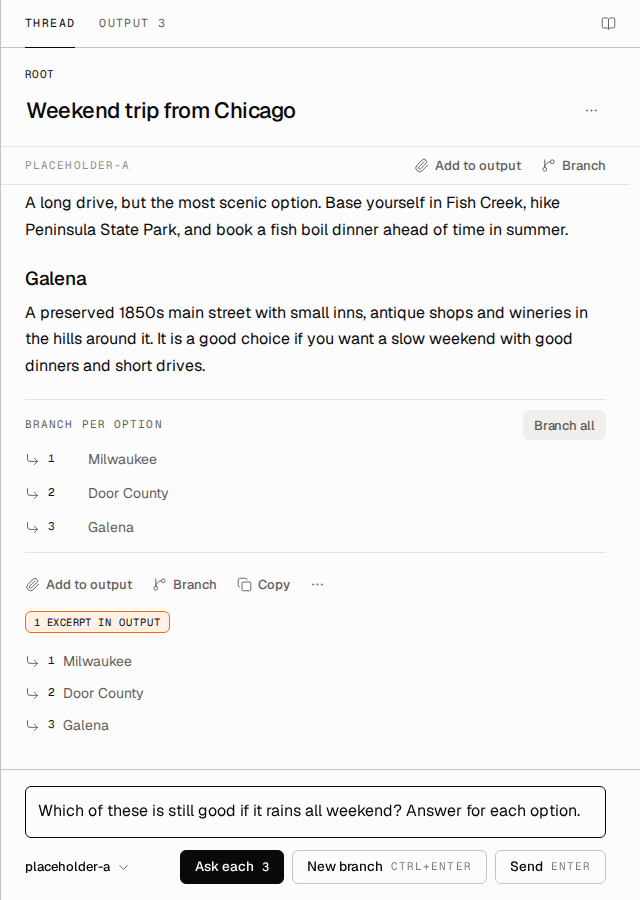
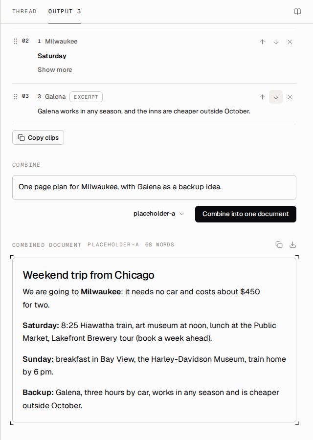

# prompt-tree

In a normal chat, every side question lands in the same thread, and the model reads all of it from then on; in prompt-tree a conversation is a tree of cards, and each branch sends the model only its own path back to the root.


- Decide per message whether it continues the current card or starts a new branch, and change your mind later by moving messages to a new branch or merging a branch back.
- Use "Ask each" to send one question to every option in an answer at once, each in its own card.
- Collect whole answers or selected excerpts from any branch and combine them into one final document.

## Quick start

You need Node 22 or newer and pnpm.

Try it first without a key (answers are placeholder text):

```sh
git clone https://github.com/Arunjay4213/prompt-tree.git
cd prompt-tree
pnpm install
pnpm dev:demo
```

Then open http://localhost:5173.

### Use real models

```sh
cp .env.example .env
```

Open `.env`, set at least one provider (see below), then run:

```sh
pnpm dev
```

Never commit `.env`.

## Models

A provider is active when its settings are in `.env`.
You can set several at once and pick the model per message.
`.env.example` lists every variable with a comment.

- **OpenAI** (Responses API): `OPENAI_API_KEY`, and optionally `OPENAI_MODELS` (comma separated model names).
- **Anthropic** (Claude, Messages API): `ANTHROPIC_API_KEY`, and optionally `ANTHROPIC_MODELS`.
  Claude support is implemented against Anthropic's current API but has not yet been verified with a real key.
- **Any OpenAI-compatible endpoint** (Chat Completions): `COMPATIBLE_BASE_URL` and `COMPATIBLE_MODELS`, plus `COMPATIBLE_API_KEY` if the endpoint needs one and `COMPATIBLE_NAME` for the label in the model picker.
  For OpenRouter, use `COMPATIBLE_BASE_URL=https://openrouter.ai/api/v1` with your OpenRouter key.
  For Ollama on the same machine, use `COMPATIBLE_BASE_URL=http://localhost:11434/v1` and no key.
- **opencode**: run `opencode serve`, then set `OPENCODE_URL` to the address it prints and `OPENCODE_PASSWORD` to its password, and optionally `OPENCODE_MODELS` (names in `provider/model` form).
  opencode then supplies whatever access it holds, such as a ChatGPT plan, GitHub Copilot, API keys or local models, and prompt-tree never sees those logins.
  Each answer runs in a fresh opencode session with every tool denied, and the session is deleted afterwards.

The opencode path has two limits.
The earlier messages of a branch are sent as one transcript inside a single prompt, and opencode's own base instructions still apply, so answers can read a little differently from the same model called directly.

`DEFAULT_MODEL` (as `<provider>:<model name>`, for example `openai:gpt-6-luna`) picks the default model, and `PORT` changes the server port (default 8787).

## How to use it

Type a first question on the start screen.
The answer appears in the root card on the canvas and in the panel on the right.

**Sending.**
The composer has up to three actions.
Send (Enter) adds your message to the selected card.
New branch (Ctrl+Enter) starts a new card after the last message of the selected card.
Ask each (Ctrl+Shift+Enter) appears when the last answer contains options.
Shift+Enter makes a new line.



**Ask each.**
It sends your question to every option at once: one new branch per option, titled with the option, all answering in parallel.
The question is rewritten for each branch so that it asks about that option only.

**Branching from an earlier point.**
Press Branch under any finished answer to start an empty card right after it.
Select text inside an answer to get Add to output (save the excerpt) and Branch with selection (a new branch whose message starts with the selection quoted).
When an answer lists options, Branch per option under it starts one branch for an option, and Branch all starts one for each.
On a branch, Another branch from the same message starts a sibling card.

**Keeping the tree readable.**
The `...` menu of a card has Collapse card (show only its title on the map) and Hide branches (hide every card that comes from it).
Fold all cards, Open all cards and Fit view are in the top bar.

**Changing your mind.**
Move to a new branch, in the `...` menu of a message, moves that message and the ones after it into their own card.
Merge into parent, in the card's `...` menu, puts a branch's messages back into the card it came from.
Both keep what the model sees for every message exactly the same.

**Final output.**
Add to output saves a whole answer, and a text selection saves an excerpt.
The Output tab lists what you saved: reorder, remove or copy the items, add an optional note, and press Combine into one document to have the model write the final text.
The result can be copied or downloaded as a `.md` file.



**Models.**
The model picker sits next to the composer buttons.
The choice applies to the next message, so different branches can use different models, and each answer shows which model wrote it.

**Reading mode.**
The book button at the top right of the panel widens it for long answers.

**Keyboard on the canvas** (when you are not typing):

- Arrow keys move the selection: Left to the parent, Right to the first branch, Up and Down to siblings.
- Enter puts the cursor in the composer of the selected card.
- F collapses or expands the selected card.
- Escape clears the selection.
- Alt+N starts a new conversation from anywhere in the app.

## Privacy

- The server listens only on 127.0.0.1, so other machines cannot reach it.
- Your keys stay in `.env` on your machine and are sent only to the provider you configured.
- Conversations are JSON files in `data/` on your disk (`data/conversations`, or `data/demo` in demo mode).
- Nothing is sent anywhere else: no analytics, and fonts and icons are bundled.
- Unsent drafts and interface preferences (panel width, chosen model, dismissed tip) are kept in the browser's local storage.

## How it works

For a new message in a branch, the app walks up to the root and takes, from each ancestor card, the messages up to the one the branch leaves from, then the branch's own earlier messages; sibling branches are never included.
The web app saves the whole conversation after each change, and every save names the stored version it is based on, so if another tab saved first, the server refuses the save and the tab asks which version to keep instead of overwriting it.
With a real model, a card first takes its title from your first message and then gets a short title written by the model; a title you type yourself is never replaced.

## Project layout

- `shared/api.ts` - the contract between the web app and the server: data shapes and the HTTP API.
- `server/index.ts` - the Hono server: JSON routes, the streaming route, and serving the built app.
- `server/model.ts` - the model registry: available models, the server mode, and routing a request to its provider.
- `server/providers/` - one file per provider (OpenAI, Anthropic, compatible, opencode, demo).
- `server/store.ts` - the JSON file store with atomic writes and the version check.
- `src/tree.ts` - all tree logic as pure functions (branch, split, merge, delete, context, numbering, layout).
- `src/store.ts` - the app state, streaming, and saving.
- `src/components/` - the React interface: canvas, cards, panel, sidebar, top bar, composer.
- `tools/e2e.mjs` - the browser run behind `pnpm e2e`.
- `docs/` - the images in this README.
- `data/` - stored conversations (not committed).
- `CLAUDE.md` - behaviour specification and engineering rules.
- `DESIGN.md` - visual specification.

## Development

- `pnpm typecheck` checks the web app and the server.
- `pnpm build` then `pnpm start` serves the built app from the server alone, on http://127.0.0.1:8787.
- `pnpm e2e` drives the running demo app in a real browser through the main flows.
  Start `pnpm dev:demo` first, and run `pnpm exec playwright install chromium` once beforehand.

## Credits

- [React Flow](https://reactflow.dev) by xyflow for the canvas.
- [Geist](https://vercel.com/font) and Geist Mono fonts.
- [Lucide](https://lucide.dev) icons.
- [Radix](https://www.radix-ui.com) primitives for menus, tooltips and dialogs.
- [dnd-kit](https://dndkit.com) for reordering saved items.
- [Hono](https://hono.dev) for the server.

## License

MIT, see [LICENSE](LICENSE).
