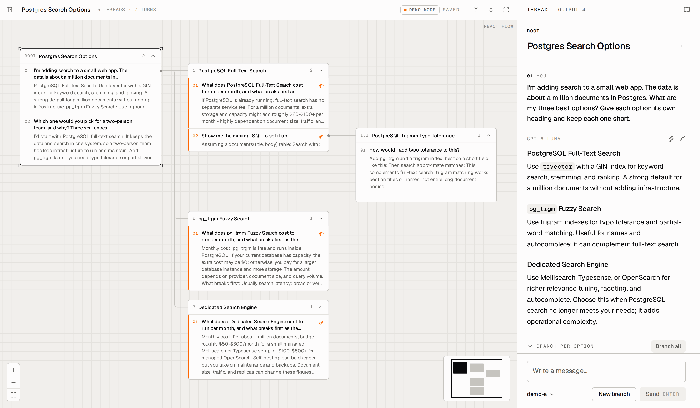
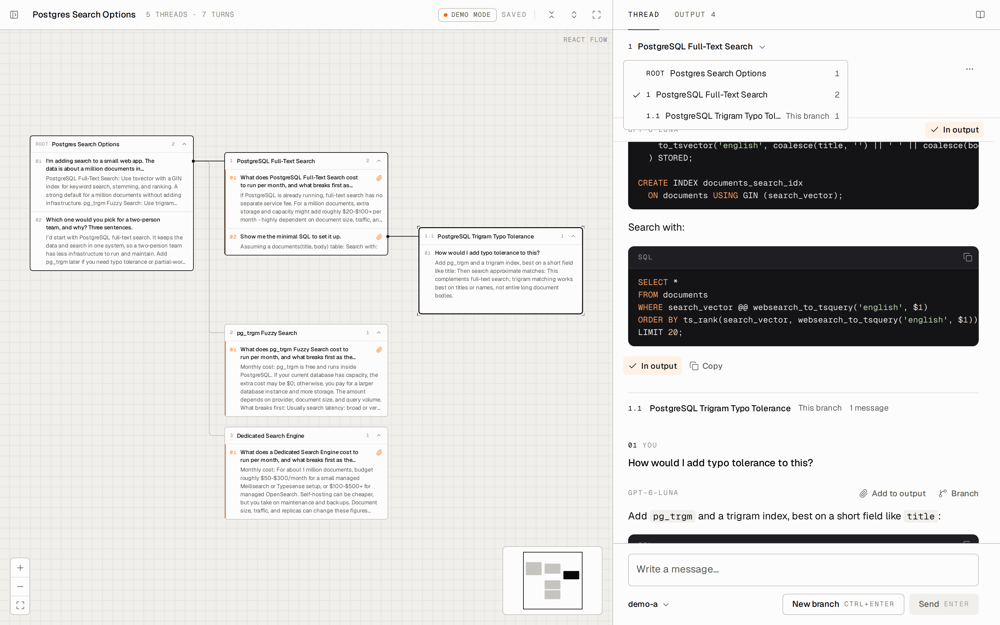

# prompt-tree

prompt-tree is a local web app for talking to a language model in a tree of branches instead of one long chat.

In a normal chat, every side question lands in the same thread, and the model reads all of it from then on.
Here you start a branch for each side question, and each branch sends the model only its own path back to the first question.
When you are done, you collect the best answers and excerpts from any branch and combine them into one final document.


- Decide per message whether it continues the current card or starts a new branch, and move messages between cards later.
- Send one question to every option in an answer at once with Ask each, and get one card per option.
- Read the whole conversation a branch can see, from the first question down, inside the branch itself.
- Collect whole answers or selected excerpts from any branch, combine them into one document, and pick the model for each message.

## Try it in one minute

You need Node 22 or newer and pnpm.

```sh
git clone https://github.com/Arunjay4213/prompt-tree.git
cd prompt-tree
pnpm install
pnpm dev:demo
```

Open http://localhost:5173.
Demo mode needs no API key and makes no network calls.
It opens with a conversation recorded from a real model, about three ways to add search to a Postgres app, already branched and combined.
Click a card on the canvas to read its branch, or press New conversation and then the "Try: ..." button to watch the recorded answers arrive.

## Use real models

```sh
cp .env.example .env
```

Open `.env`, set at least one provider, then run:

```sh
pnpm dev
```

Never commit `.env`.

A provider is active when its settings are in `.env`.
You can set several and pick the model per message.
`.env.example` explains every variable.

- **OpenAI** (Responses API): `OPENAI_API_KEY`, and optionally `OPENAI_MODELS` (comma separated).
- **Anthropic** (Messages API): `ANTHROPIC_API_KEY`, and optionally `ANTHROPIC_MODELS`.
  Claude support is written against Anthropic's current API but has not yet been verified with a real key.
- **Any OpenAI-compatible endpoint** (Chat Completions): `COMPATIBLE_BASE_URL` and `COMPATIBLE_MODELS`, plus `COMPATIBLE_API_KEY` if the endpoint needs one and `COMPATIBLE_NAME` for the label in the model picker.
  OpenRouter: `COMPATIBLE_BASE_URL=https://openrouter.ai/api/v1` with your OpenRouter key.
  Ollama on the same machine: `COMPATIBLE_BASE_URL=http://localhost:11434/v1` and no key.
- **opencode**: run `opencode serve`, set `OPENCODE_URL` to the address it prints and `OPENCODE_PASSWORD` to its password, and optionally `OPENCODE_MODELS` (as `provider/model`).
  opencode supplies whatever access it holds, such as a ChatGPT plan, GitHub Copilot, API keys or local models, and prompt-tree never sees those logins.
  Each answer runs in a new opencode session with every tool denied, and the session is deleted afterwards.
  Sessions left behind when opencode stops mid-answer are deleted the next time prompt-tree starts.
  The sessions use a plain chat agent that prompt-tree writes into the folder its sessions run in, so opencode's coding-agent instructions do not apply.

The opencode path has two limits.
The earlier messages of a branch are sent as one transcript inside a single prompt.
opencode still adds its date and environment context, and your global AGENTS.md if you have one.
So answers can read a little differently from the same model called directly.

`DEFAULT_MODEL` picks the default model, as `<provider>:<model name>` (for example `openai:gpt-6-luna`).
`PORT` changes the server port (default 8787).

## How to use it

Type a first question on the start screen.
The answer appears in the root card on the canvas and in the panel on the right.



### Sending

The composer under the panel has up to three actions.

- **Send** (Enter) adds your message to the selected card.
- **New branch** (Ctrl+Enter) starts a new card after the last message of the selected card.
  With an empty box it starts an empty card.
- **Ask each** (Ctrl+Shift+Enter) appears when the last answer lists options, or when your question says "each" and the last answer has headings or a list.
  It sends your question to every option at once: one new card per option, titled with the option, all answering in parallel.
  The question is rewritten for each card so it asks about that option only.

Shift+Enter makes a new line.
When your question says "each", "both", "every" or similar, Ask each becomes the main button.


### Branching from an earlier point

- **Branch**, under any finished answer, starts an empty card right after it.
- **Branch per option** appears under an answer that lists options.
  Click an option to start a card for it, or **Branch all** to start one for each.
- Select text in an answer to get **Branch with selection** (a new card whose message starts with the selection quoted) and **Add to output**.
- **Another branch from the same message**, at the top of a branch, starts a sibling card.

### Reading a branch

Opening a branch shows everything it can see, from the root down to the branch, as one scroll grouped by generation.
Every earlier answer is shown in full, and you can copy it or add it to the output from there.
The dropdown at the top of the panel lists the generations on the path (`ROOT`, `1`, `1.1`, ...) and jumps to the one you choose.
Each earlier generation has an **Open card** button.



### Keeping the tree readable

The `...` menu next to a card's title has **Collapse card** (show only its title on the map) and **Hide branches** (hide every card that comes from it).
**Fold all cards**, **Open all cards** and **Fit view** are in the top bar.

### Changing your mind

- **Move to a new branch**, in the `...` menu under a message, moves that message and the ones after it into their own card.
- **Merge into parent**, in the card's `...` menu, puts a branch's messages back into the card it came from.

Both keep what the model sees for every message exactly the same.

### Final output

**Add to output** under an answer saves the whole answer, and a text selection saves an excerpt.
The Output tab lists what you saved.
You can reorder, remove or copy the items, add an optional instruction, and press **Combine into one document** to have the model write the final text.
The result can be copied or downloaded as a `.md` file.


### Models

The model picker sits next to the composer buttons.
The choice applies to the next message, so different branches can use different models.
Each answer shows which model wrote it.

### Reading mode

The book button at the top right of the panel widens it for long answers.

### Keyboard on the canvas

When you are not typing:

- Arrow keys move the selection: Left to the parent, Right to the first branch, Up and Down to siblings.
- Enter puts the cursor in the composer of the selected card.
- F collapses or expands the selected card.
- Escape clears the selection.

Alt+N starts a new conversation from anywhere in the app.

## Privacy

- The server listens only on 127.0.0.1, so other machines cannot reach it.
- Your keys stay in `.env` on your machine and are sent only to the provider you configured.
- Conversations are JSON files on your disk: `data/conversations`, or `data/demo` in demo mode.
- Nothing is sent anywhere else: there are no analytics, and fonts and icons are bundled.
- Unsent drafts and interface preferences (panel width, chosen model, dismissed tip) are kept in the browser's local storage.

## How it works

For a new message in a branch, the app walks up to the root.
From each ancestor card it takes the messages up to the one the branch leaves from, then adds the branch's own earlier messages.
Sibling branches are never included.

The web app saves the whole conversation after each change.
Every save names the stored version it is based on.
If another tab saved first, the server refuses the save, and the tab asks which version to keep instead of overwriting it.

With a real model, a card first takes its title from your first message and then gets a short title written by the model.
A title you type yourself is never replaced.

Demo mode keeps its conversations in `data/demo`, apart from real ones.
When that folder is empty at server start, the recorded sample is copied in again.
The suggested question replays the recorded answers.
Any other question gets a short sample answer with three headings.
The headings become options to branch from when your question asks for options, and a follow-up that says "each" brings up Ask each.
Combine replays the recorded document when everything you collected comes from the sample, and otherwise joins the collected items in order.
The two demo models are `demo-a` and `demo-b`.

## Project layout

- `shared/api.ts` - the contract between the web app and the server: data shapes and the HTTP API.
- `server/index.ts` - the Hono server: JSON routes, the streaming route, and serving the built app.
- `server/model.ts` - the model registry: available models, the server mode, and routing a request to its provider.
- `server/providers/` - one file per provider (OpenAI, Anthropic, compatible, opencode, demo).
- `server/demo/` - the recorded sample conversation for demo mode and the question that was asked with Ask each.
- `server/store.ts` - the JSON file store with atomic writes and the version check.
- `src/tree.ts` - all tree logic as pure functions (branch, split, merge, delete, context, numbering, layout).
- `src/store.ts` - the app state, streaming, and saving.
- `src/components/` - the React interface: canvas, cards, panel, sidebar, top bar, composer.
- `tools/e2e.mjs` - the browser run behind `pnpm e2e`.
- `docs/` - the images in this README.
- `data/` - stored conversations (not committed).
- `CLAUDE.md` - behaviour specification and engineering rules.
- `DESIGN.md` - visual specification.

## Development

- `pnpm typecheck` checks the web app and the server.
- `pnpm build` then `pnpm start` serves the built app from the server alone, on http://127.0.0.1:8787.
  To try the built app in demo mode, run `pnpm build`, then `pnpm start:demo`, and open http://127.0.0.1:8787.
- `pnpm e2e` drives the running demo app in a real browser through the main flows.
  Start `pnpm dev:demo` first, and run `pnpm exec playwright install chromium` once beforehand.

## Credits

- [React Flow](https://reactflow.dev) by xyflow for the canvas.
- [Geist](https://vercel.com/font) and Geist Mono fonts.
- [Lucide](https://lucide.dev) icons.
- [Radix](https://www.radix-ui.com) primitives for menus, tooltips and dialogs.
- [dnd-kit](https://dndkit.com) for reordering saved items.
- [Hono](https://hono.dev) for the server.

## License

MIT, see [LICENSE](LICENSE).
